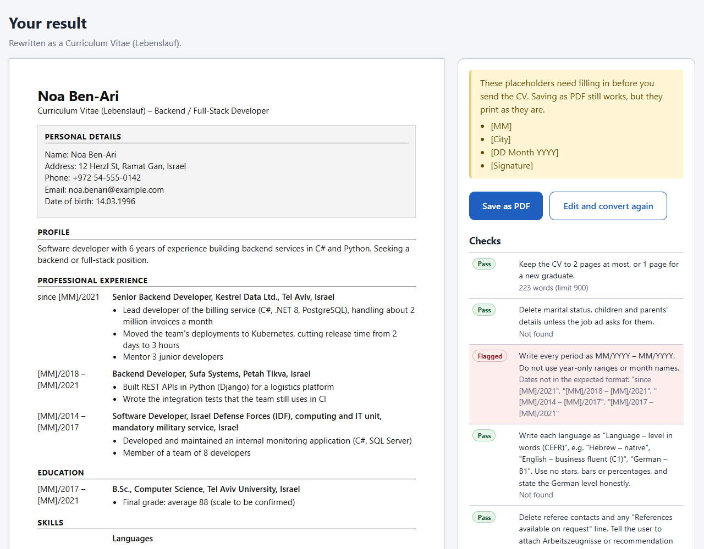

# CV Converter

Rewrites a CV to another country's hiring norms and explains every change it makes, with a link to where each rule comes from.

It works in both directions through Israel:
- **Israelis applying abroad:** an Israeli CV, including army service, into a US résumé, a UK CV or a German Lebenslauf.
- **Olim and other newcomers:** a CV from abroad into Israeli norms.



## Demo video
- Watch online: [Google Drive](https://drive.google.com/file/d/1eXZ1qOJSyCnlHD-ZblDUQSlS_VP8j-7t/view?usp=sharing) (2 minutes, recorded from real runs of the app on the fictional test CVs)
- The file itself: [docs/demo/cv-converter-demo.mp4](docs/demo/cv-converter-demo.mp4)

## Status
Built during the Developers Institute hackathon (Full Stack + AI, part-time, May 2026 – December 2026), 15–20 October 2026. Work started on 13 October, the original start date, before the hackathon was postponed. Each milestone landed as its own pull request.

What shipped:
- Paste a CV as text.
- Convert in four directions: an Israeli CV into a US résumé, a UK CV or a German Lebenslauf, and a CV from abroad into Israeli norms.
- Per-rule checks on the result, each marked Pass or Flagged.
- Every change explained, with the rule's source.
- Country layouts: a single column for the US, the UK and Israel; for Germany, a date column, a Personal Details block and a signature line.
- Save as PDF on A4 or US Letter, as the country expects.
- Ratings: a short form on the result page.

File upload (.docx and .pdf, milestone M7) was dropped at the 18 October time box. Paste still works without it.

## Team
Paul Rivlin, solo ([GitHub: privlin-lgtm](https://github.com/privlin-lgtm)).

## Technologies
- TypeScript
- React 19 with Redux Toolkit and React Router, built with Vite
- Node.js with Express 5
- PostgreSQL with Knex
- Zod for validation
- The Claude API through the Anthropic TypeScript SDK, with structured output (the model comes from `ANTHROPIC_MODEL`, set to `claude-sonnet-5-5` in `server/.env.example`)
- Vitest, Testing Library and supertest for tests
- oxlint for linting
- GitHub Actions for CI

## How it works
1. The country rules (photo, date of birth, date format, length, paper size, how to describe army service and more) live in PostgreSQL, each with its sources.
2. The server sends the target country's rules and the CV to the Claude API, which returns the rewritten CV and a list of changes in a fixed structure.
3. Automatic checks test the result against the key rules, and the app asks for missing facts instead of inventing them.
4. "Save as PDF" uses the browser's print dialog, on A4 or US Letter as the country expects.

## Run it locally
**Prerequisites:** Node.js (LTS), PostgreSQL, and an Anthropic API key from the Anthropic Console. The API uses port 3001 and the client uses port 5173, so both must be free; leave `PORT` in `server/.env` at 3001, because the client's dev proxy expects the API there.

1. Clone the repo and open its folder:
   ```
   git clone https://github.com/privlin-lgtm/cv-converter
   cd cv-converter
   ```
2. Create two empty databases, `cv_converter_dev` and `cv_converter_test`, with `createdb` (it comes with PostgreSQL) or in pgAdmin:
   ```
   createdb cv_converter_dev
   createdb cv_converter_test
   ```
3. Install the dependencies from the repo root:
   ```
   npm install
   ```
4. Copy the example config to `server/.env`. In macOS, Linux or Git Bash:
   ```
   cp server/.env.example server/.env
   ```
   In PowerShell:
   ```
   Copy-Item server/.env.example server/.env
   ```
   Then open `server/.env` and fill in `ANTHROPIC_API_KEY`, `DATABASE_URL` (the `cv_converter_dev` database) and `DATABASE_URL_TEST` (the `cv_converter_test` database). Each database URL is `postgres://`, then your PostgreSQL user and password, then `@localhost:5432/` and the database name. `ANTHROPIC_MODEL` and `PORT` already have values. `server/.env` is git-ignored; never commit it.
5. Create the tables and load the country rules into the dev database:
   ```
   npm run db:migrate
   npm run db:seed
   ```
6. Start the app, then open http://localhost:5173:
   ```
   npm run dev
   ```
   The client runs on port 5173 and the API on port 3001. The app opens on the Convert page. Paste a CV, pick a direction and click Convert; after up to a minute you land on the result page. It shows the rewritten CV on the left, laid out for the target country (for Germany, a date column, a Personal Details block and a signature line), and a panel on the right with the rule checks, questions for you, the changes with their reasons and sources, and notes. The result lives only in this browser tab: reload and you're sent back to the Convert page. Save as PDF opens your browser's print dialog, set to the paper size the country expects (Letter for the US, A4 for the rest); if the CV still has bracketed placeholders such as [City], a notice lists them first. The last block in the panel is a rating form: compared with a chatbot, was the result better, the same or worse (or you didn't try one), a score from 1 to 5 and an optional comment; it saves the rating, never the CV.
7. Run the tests and the linter:
   ```
   npm test
   npm run lint
   ```
   The tests use only the `cv_converter_test` database (`DATABASE_URL_TEST`), which they migrate and seed themselves before the run. They use a fake model, so they need no `ANTHROPIC_API_KEY` and make no calls to the Claude API. Only pressing Convert in the running app calls it.

## Limitations
- English in and out only.
- US, UK, Germany and Israel only.
- Paste only; there is no file upload.
- Some rules are labelled "common practice" because their sources haven't been verified.
- Some checks test only part of their rule.
- Not deployed; it runs locally only.

## Privacy
The app never stores a CV. It is sent to the Claude API to be rewritten and shown only to the user. Anthropic deletes API inputs and outputs within 30 days, and keeps them for up to 2 years only if they are flagged for a usage-policy breach. The app logs no CV text: each conversion logs only the model, the direction, the status, the token counts and the time taken. All tests use made-up CVs.

## Planning documents
- [Intent](intent/2026-10-10-mvp/intent.md)
- [Spec](intent/2026-10-10-mvp/spec.md)
- [Plan](intent/2026-10-10-mvp/plan.md)
- [Research: CV norms by country, with sources](research/cv-norms-2026-10.md)

© 2026 Paul Rivlin. All rights reserved.
